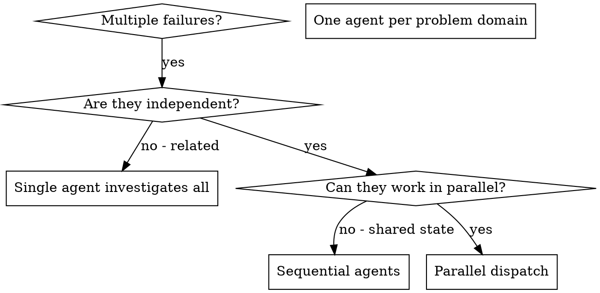

# Dispatching Parallel Agents

## Overview

You delegate tasks to specialized agents with isolated context. By precisely crafting their instructions and context, you ensure they stay focused and succeed at their task. They should never inherit your session's context or history — you construct exactly what they need. This also preserves your own context for coordination work.

When you have multiple unrelated failures (different test files, different subsystems, different bugs), investigating them sequentially wastes time. Each investigation is independent and can happen in parallel.

**Core principle:** Dispatch one agent per independent problem domain. Let them work concurrently.


## In our system (Open Minis + the HQ VM) — added 2026-11-27

The pattern above is upstream (`obra/superpowers`). These are OUR constraints, and they change
the arithmetic.

| Fact | Value | Source |
|---|---|---|
| The tool | `subagent_task` — **app-side**; Open Minis sends it to the model | Settings → Agent Runtime → Sub Agents (`minis-config chat.tools.subAgents`), on by default |
| Who can dispatch | only a session running **inside the app**. A VM-only process (hq-core, cron, a worker) cannot: neither door carries such a tool | `minis-tools` = 10 tools, `vm-hq-gate` = 3, none of them a dispatcher |
| Concurrency | **3 at a time per conversation**; extras queue and start as slots free | `/var/minis/docs/concepts/subagents.md` |
| Budget | **60 minutes total per run**, one 90-second no-tool wrap-up at the end | same |
| Child session | no memory (no `GLOBAL.md`, no `memory_write`), no SOUL persona, cannot see the parent conversation | same |
| Models | roster group is `Sub-agents`; Peach pins the group per roster entry (max 10 agents) | `minis-config get subagents` |
| Result | arrives in the parent chat as `<agent_callback>`; levers are `status` / `steer` / `cancel` / `extend` / `resume` | same |

Two consequences for the pattern above:

1. **Batch by 3, not by all.** Issue at most three dispatches in one response, then wait for a
   slot. Queueing eight heavy investigations on a 2-vCPU VM only moves the wait — see
   `specs/N3-parallel-shell.md` for the measured door cost (3.0 s flat per call).
2. **Use parallel sub-agents for investigation, not for VM-heavy work.** Each sub-agent's
   shell calls ride the same door, so N of them at once multiply that toll.

### Reporting: the team-readable record (RULE 19)

A sub-agent's answer comes back in the parent chat — that is for the parent, not the team.
When Peach has ordered a report, the team-readable record goes to one place only, in English:

```
bin/peach_report.py --lane <lane> --kind subagent --ordered \
  --title "<what was checked>" --task "<what was asked>" --result "<findings>" \
  [--evidence '<url + sha256>'] [--job <WO-id>]
```

→ `lanes/<lane>/workspace/reports/<YYYYMMDD-HHMM>-<slug>-en.json`. No order = no file; the
pad stays the SSOT. A sub-agent's behaviour comes from the roster entry's instructions —
`bin/subagent_instructions.py` prints the canonical text, so never hand-write a second copy.

## When to Use



**Use when:**
- 3+ test files failing with different root causes
- Multiple subsystems broken independently
- Each problem can be understood without context from others
- No shared state between investigations

**Don't use when:**
- Failures are related (fix one might fix others)
- Need to understand full system state
- Agents would interfere with each other

## The Pattern

### 1. Identify Independent Domains

Group failures by what's broken:
- File A tests: Tool approval flow
- File B tests: Batch completion behavior
- File C tests: Abort functionality

Each domain is independent - fixing tool approval doesn't affect abort tests.

### 2. Create Focused Agent Tasks

Each agent gets:
- **Specific scope:** One test file or subsystem
- **Clear goal:** Make these tests pass
- **Constraints:** Don't change other code
- **Expected output:** Summary of what you found and fixed

### 3. Dispatch in Parallel

Issue all three subagent dispatches in the same response — they run in parallel.
Three is also our ceiling per conversation, so a fourth dispatch queues instead.

```text
Subagent (general-purpose): "Fix agent-tool-abort.test.ts failures"
Subagent (general-purpose): "Fix batch-completion-behavior.test.ts failures"
Subagent (general-purpose): "Fix tool-approval-race-conditions.test.ts failures"
# All three run concurrently.
```

Multiple dispatch calls in one response = parallel execution. One per response = sequential.

### 4. Review and Integrate

When agents return:
- Read each summary
- Verify fixes don't conflict
- Run full test suite
- Integrate all changes

## Agent Prompt Structure

Good agent prompts are:
1. **Focused** - One clear problem domain
2. **Self-contained** - All context needed to understand the problem
3. **Specific about output** - What should the agent return?

```markdown
Fix the 3 failing tests in src/agents/agent-tool-abort.test.ts:

1. "should abort tool with partial output capture" - expects 'interrupted at' in message
2. "should handle mixed completed and aborted tools" - fast tool aborted instead of completed
3. "should properly track pendingToolCount" - expects 3 results but gets 0

These are timing/race condition issues. Your task:

1. Read the test file and understand what each test verifies
2. Identify root cause - timing issues or actual bugs?
3. Fix by:
   - Replacing arbitrary timeouts with event-based waiting
   - Fixing bugs in abort implementation if found
   - Adjusting test expectations if testing changed behavior

Do NOT just increase timeouts - find the real issue.

Return: Summary of what you found and what you fixed.
```

## Common Mistakes

**❌ Too broad:** "Fix all the tests" - agent gets lost
**✅ Specific:** "Fix agent-tool-abort.test.ts" - focused scope

**❌ No context:** "Fix the race condition" - agent doesn't know where
**✅ Context:** Paste the error messages and test names

**❌ No constraints:** Agent might refactor everything
**✅ Constraints:** "Do NOT change production code" or "Fix tests only"

**❌ Vague output:** "Fix it" - you don't know what changed
**✅ Specific:** "Return summary of root cause and changes"

## When NOT to Use

**Related failures:** Fixing one might fix others - investigate together first
**Need full context:** Understanding requires seeing entire system
**Exploratory debugging:** You don't know what's broken yet
**Shared state:** Agents would interfere (editing same files, using same resources)

## Real Example from Session

**Scenario:** 6 test failures across 3 files after major refactoring

**Failures:**
- agent-tool-abort.test.ts: 3 failures (timing issues)
- batch-completion-behavior.test.ts: 2 failures (tools not executing)
- tool-approval-race-conditions.test.ts: 1 failure (execution count = 0)

**Decision:** Independent domains - abort logic separate from batch completion separate from race conditions

**Dispatch:**
```
Agent 1 → Fix agent-tool-abort.test.ts
Agent 2 → Fix batch-completion-behavior.test.ts
Agent 3 → Fix tool-approval-race-conditions.test.ts
```

**Results:**
- Agent 1: Replaced timeouts with event-based waiting
- Agent 2: Fixed event structure bug (threadId in wrong place)
- Agent 3: Added wait for async tool execution to complete

**Integration:** All fixes independent, no conflicts, full suite green

## Verification

After agents return:
1. **Review each summary** - Understand what changed
2. **Check for conflicts** - Did agents edit same code?
3. **Run full suite** - Verify all fixes work together
4. **Spot check** - Agents can make systematic errors
